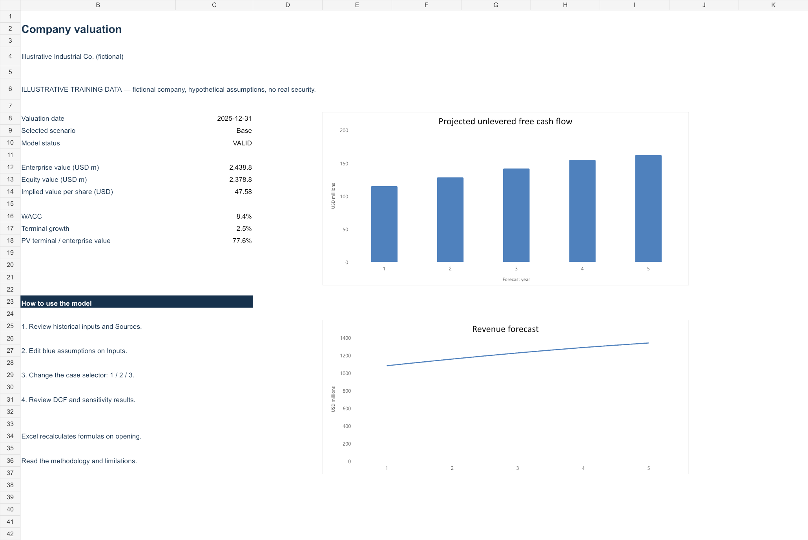
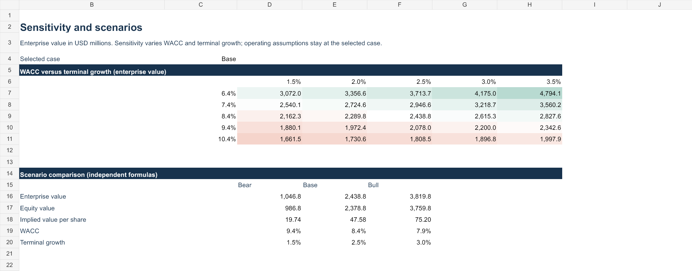

# Automated Company Valuation Engine

A compact Python project that turns reviewed annual financial data into an auditable, formula-driven Excel DCF. Built for an undergraduate finance portfolio and technical interview discussion.

## Run the complete example

If you already installed the project packages, open a terminal in this folder and run:

```powershell
.\.venv\Scripts\python.exe run_demo.py --open
```

This creates `outputs/demo/valuation.xlsx` on your computer and opens it in your default spreadsheet application. Recalculate and save the workbook in Excel. To run the tests:

```powershell
.\.venv\Scripts\python.exe -m pytest -q
```

If you cloned the repository onto a new computer, follow Quick start below first. The repo includes a complete worked example under `examples/illustrative/`. Resume bullets, a LinkedIn Projects description and a launch-post draft are in [the portfolio kit](docs/portfolio-kit.md).

**The included example is a fictional training company. Every example value and forecast assumption is constructed and labeled illustrative. It is not a valuation of a real security.** The SEC integration is implemented and tested with fixtures and mocked HTTP responses. A full live company download was not performed during this build because no real SEC contact identity was supplied.



## Quick start

Requires Python 3.11 or newer. Excel or LibreOffice is needed to recalculate newly generated workbooks. Python calculates the valuation independently without either application.

```bash
python -m venv .venv
```

Activate it in Windows PowerShell:

```powershell
.venv\Scripts\Activate.ps1
```

Or macOS/Linux:

```bash
source .venv/bin/activate
```

From this project directory:

```bash
python -m pip install -e .
python -m pytest -q
python -m valuation_engine value --history sample_data/illustrative_history.csv --assumptions sample_data/illustrative_assumptions.json --out outputs/demo
```

Open `outputs/demo/valuation.xlsx`, let Excel recalculate, then save it. In Excel, **Ctrl+Alt+F9** forces a full recalculation. Check the saved values against Python:

```bash
python scripts/verify_cached.py outputs/demo/valuation.xlsx outputs/demo/valuation.json
python scripts/plot_forecast.py outputs/demo/forecast_base.csv outputs/demo/forecast.png
```

For LibreOffice, write the recalculated copy into a **different** directory:

```bash
soffice --headless --convert-to xlsx --outdir outputs/recalculated outputs/demo/valuation.xlsx
python scripts/verify_cached.py outputs/recalculated/valuation.xlsx outputs/demo/valuation.json
```

The cached-value verifier assumes the saved workbook is restored to **Base**, matching the original CSV/JSON assumptions. If you intentionally change Excel inputs, regenerate the Python result with matching assumptions before comparing.

`openpyxl` writes formulas but does not calculate them. The bundled example has been calculated with a compatible spreadsheet engine and its saved results independently checked against Python. Native Excel automation was unavailable in the build environment. Fresh CLI exports require recalculation. See [validation evidence](docs/validation.md).

## What the example produces

All enterprise/equity values below are USD millions. Shares are in millions, so equity value divided by shares gives USD per share directly.

| Fictional scenario | Enterprise value | Equity value | Value / share |
|---|---:|---:|---:|
| Bear | 1,046.78 | 986.78 | 19.74 |
| Base | 2,438.80 | 2,378.80 | 47.58 |
| Bull | 3,819.81 | 3,759.81 | 75.20 |

The Base assumptions include a 9.50% cost of equity and 8.425% WACC. They are hypothetical, not market observations. Displayed percentages are rounded; calculations retain precision. About 77.6% of Base enterprise value comes from the discounted terminal value, which shows why the long-run assumptions matter.

Outputs include `valuation.xlsx`, `valuation.json`, `summary.md`, normalized annual history, and a forecast CSV for each scenario. The charts inside Excel use formula-linked series. The optional matplotlib script produces a standalone chart.

## Architecture and milestones

```text
valuation-engine/
  src/valuation_engine/
    sec.py          SEC client, caching, ticker-to-CIK resolution, fact selection
    data.py         CSV validation, annual-period/unit normalization, review gates
    model.py        CAPM, WACC, five-year FCFF, stable year 6, discounting
    excel.py        Native Excel formulas, formatting, charts, sensitivities
    cli.py          fetch-sec and value commands, logs and reports
  sample_data/      Clearly labeled fictional sample and blank manual templates
  examples/illustrative/  Working example outputs
  tests/            pytest suite with hand-checkable financial examples
  scripts/          Plotting and saved-workbook comparison
  docs/             Workbook previews, validation, interview preparation
  requirements.txt
  pyproject.toml
```

The completed milestones were: (1) tested valuation math, (2) SEC/manual data normalization, (3) formula-driven Excel and full pipeline, and (4) spreadsheet-engine comparisons, visual review and documentation. The implementation stays command-line based so its finance logic is easy to inspect before considering a UI.

## Use a real public company

For an initial project, choose a US-GAAP **nonfinancial operating company** with understandable revenue and investment drivers. This version does not support banks, insurers, IFRS mappings, multiple share classes or complex financial institutions automatically.

Set your actual application/person identity and contact email in an environment variable. Replace the example email before using the SEC command.

```powershell
$env:SEC_USER_AGENT = "YourName ValuationProject your.real.email@your-domain.com"
python -m valuation_engine fetch-sec AAPL --years 3 --out outputs/aapl_sec
```

macOS/Linux:

```bash
export SEC_USER_AGENT="YourName ValuationProject your.real.email@your-domain.com"
python -m valuation_engine fetch-sec AAPL --years 3 --out outputs/aapl_sec
```

The importer downloads the SEC ticker map, resolves the CIK, then requests company facts. It saves:

- `companyfacts_raw.json`: the original API payload.
- `history_unreviewed.csv`: annual observations, with missing values left blank.
- `provenance.json`: selected concept, raw value/unit, period, accession, filing date, retrieval timestamp and archive link.
- `review_required.json`: missing fields, mapping caveats and next steps.

Review the extracted figures against the annual filings. Fill missing values manually, document every manual input in the CSV `source` field with its filing URL, page/note and metric definition, and save a reviewed copy. If you modify SEC-extracted values, keep their original provenance and add an explicit explanation of the replacement in the reviewed CSV source and config review note. The workbook includes both the original extraction provenance and reviewed CSV row references.

Copy `sample_data/manual_assumptions.template.json`, enter your own sourced assumptions and bridge, then set `reviewed` to `true` **after** the review. You can omit `diluted_shares` to generate enterprise and equity values without a price per share.

```bash
python -m valuation_engine value --history outputs/aapl_sec/history_reviewed.csv --assumptions my_assumptions.json --provenance outputs/aapl_sec/provenance.json --out outputs/aapl_valuation
```

This command is a workflow example, not evidence that the included sample contains AAPL financial data. If SEC access fails, use the manual CSV template. The model never replaces failed downloads with sample data.

### SEC selection rules and fair access

The client uses a declared User-Agent, a reusable requests session, a 24-hour cache and a maximum of two requests per second per client instance. The SEC guidance reviewed for this project sets a maximum of 10 requests per second per user across machines. Use one downloader process and account for other applications sharing your IP. Rate-limit/server responses receive bounded retry delays. A 403 fails with an actionable CSV fallback; it is not bypassed.

Only annual 10-K/10-K/A observations with 330–380 day duration are used. Revenue defines the fiscal start/end pair. Duration metrics must match that exact pair; cash and debt components must match the fiscal end. Quarterly/YTD values are not annualized. Fiscal gaps, overlaps, duplicates and conflicting same-priority facts are rejected. Restatements use the latest available filing date. This can introduce look-ahead relative to a historical valuation date, so the data is **not a point-in-time backtesting dataset**.

Tag preferences are explicit in `sec.py`. Examples include standard revenue concepts, `OperatingIncomeLoss`, operating cash flow, PP&E cash purchases and cash/equivalents. Operating income is an EBIT proxy requiring review. D&A tags may include depletion or omit amortization. Total debt is only assembled when current long-term debt, noncurrent long-term debt and short-term borrowings are all reported; an absent component is not treated as zero. Review leases, commercial paper, scope and debt market value manually.

Operating NWC is intentionally not inferred from total current assets minus current liabilities, which can mix operating and financing balances. Custom taxonomy facts, business combinations, discontinued operations, restatements and unusual statement presentation may require a fully manual input file.

## Manual input schema

Use one row per complete, contiguous fiscal year, in any input order. At least three years are required. Columns must exist even if unsupported historical values are blank. The model requires the latest-year revenue, EBIT, D&A, capex, operating NWC, cash and debt before valuation; unsupported earlier fields remain visibly blank. It logs missing historical revenue/net income/CFO/capex/cash/debt rather than inserting zeros.

| CSV column | Meaning / convention |
|---|---|
| `fiscal_start`, `fiscal_end` | Actual annual dates, `YYYY-MM-DD`; supports ordinary 52/53-week periods within the duration limits |
| `currency` | `USD` only; no implicit FX translation |
| `unit_scale` | `1` = raw dollars/shares; `1000` = thousands; `1000000` = millions. Applies to every financial/share field in that row |
| `source` | Filing URL and page/note, definitions and manual-input provenance |
| `retrieved_at` | Source retrieval date or ISO timestamp |
| `revenue` | Annual consolidated revenue |
| `net_income` | Annual net income, with source scope reviewed |
| `cfo` | Reported cash flow from operations |
| `capex` | Positive cash investment outflow; specify included PP&E/software/intangibles |
| `cash` | Cash and cash equivalents at fiscal end; not automatically all excess cash |
| `debt` | Reviewed interest-bearing debt at fiscal end; specify leases and other components |
| `ebit` | Operating EBIT or reviewed operating-income proxy |
| `da` | Annual D&A included in EBIT; avoid duplicating overlapping disclosures |
| `operating_nwc` | Operating current assets less operating current liabilities, excluding cash, debt and financing items |
| `diluted_weighted_avg_shares` | Historical diluted EPS denominator, for context only |

The normalizer converts all monetary amounts **and shares** to millions without rounding. For example, raw USD revenue `1000000000` with scale `1` becomes `1000.0` USD million. If a source reports shares in a different scale from monetary values, convert those shares to the row's scale before loading.

`manual_history.template.csv` contains placeholder periods and blanks. It is deliberately not a runnable valuation until you fill it. The fictional sample is the runnable offline fallback for learning the workflow.

### Assumption JSON

Each named scenario has five-element arrays for `growth`, `margin`, `da_ratio`, `capex_ratio` and `nwc_ratio`. Decimal `0.08` means 8%. Ratios and projections are assumptions, not automatically inferred forecasts. `capital` contains risk-free rate, beta, equity risk premium, cost of debt, market-value debt weight and operating tax rate.

`wacc_override: null` uses calculated WACC plus the scenario's `wacc_spread`. An explicit override replaces that result; zero is invalid, not a request to use the calculated value. The bridge contains reviewed excess cash, debt and signed other adjustments, in USD millions. Explain zero adjustments as well as nonzero ones. `diluted_shares` is a **reviewed point-in-time fully diluted count in millions**, with `shares_source` and `shares_as_of` matching the valuation date. The model does not transform basic or weighted-average shares into a purported current diluted count.

## Financial methodology, explained

| Formula | Plain-language explanation |
|---|---|
| Growth = revenue / prior revenue − 1 | How much sales increased; unavailable if prior revenue is missing or zero |
| EBIT margin = EBIT / revenue | Operating profit for each dollar of sales; unavailable for zero/missing revenue |
| CFO less capex = CFO − capex | A reported cash-flow metric shown in history; it is not silently substituted for FCFF |
| Revenue(t) = revenue(t−1) × (1 + growth(t)) | Grow last year's sales by that year's assumption |
| EBIT = revenue × EBIT margin | Convert sales into operating profit before financing costs |
| Cash taxes = MAX(EBIT, 0) × tax rate | Tax positive operating profit; do not assume an immediate tax refund for losses |
| NOPAT = EBIT − cash taxes | Operating profit after assumed operating cash taxes |
| D&A = revenue × D&A ratio | Approximate noncash depreciation/amortization already deducted in EBIT |
| Capex = revenue × capex ratio | Cash invested in operating long-term assets |
| Operating NWC = revenue × NWC ratio | Cash tied up in operating receivables/inventory net of operating payables and accruals |
| Increase in NWC = closing NWC − opening NWC | More cash tied up reduces cash flow; a release adds cash flow |
| FCFF = NOPAT + D&A − capex − increase in NWC | Cash available to all capital providers after operating tax and reinvestment |
| Cost of equity = risk-free + beta × equity risk premium | A CAPM estimate of the return shareholders require |
| WACC = Ke × (1−debt weight) + Kd × (1−tax) × debt weight | Blend shareholder and lender required returns using market-value capital weights |
| PV(FCFF(t)) = FCFF(t) / (1+WACC)^t | Translate each future year-end cash flow into value at the valuation date |
| Terminal value at year 5 = FCFF(6) / (WACC−g) | Value stable cash flows from year 6 onward under perpetual growth |
| Enterprise value = sum of explicit PVs + PV of terminal value | Value the operating business before allocating value between financing claims |
| Equity value = EV + excess cash − debt + signed other adjustments | Add nonoperating assets and subtract claims senior to common shareholders |
| Value/share = equity value / reviewed diluted shares | Allocate equity value to each diluted share; omit when the denominator is unsupported |

**Why FCFF and WACC belong together:** FCFF is before interest and borrowing flows, so it belongs to lenders and shareholders. WACC compensates both. FCFE belongs to shareholders and is discounted at cost of equity. CFO minus capex alone is not complete FCFE because financing flows and statement classification can matter. Do not discount FCFF at cost of equity and then treat the result as equity value.

**Why year 6 is rebuilt:** if year-5 sales growth is 4% and terminal growth is 2.5%, year-6 working-capital investment must reflect 2.5%. The model grows revenue at `g`, keeps year-5 margins and investment ratios, recalculates NWC and its change, then calculates FCFF. Mechanically using `FCFF(5) × (1+g)` would carry the wrong working-capital investment into this transition.

**Hand check:** five years of FCFF of 10, terminal FCFF of 10, WACC 10%, and `g=0` describe a perpetual 10 cash flow. Enterprise value must be `10/10% = 100`. With cash 5, debt 20 and 10 diluted shares, equity value is `100+5−20=85`, or `8.50` per share. A test verifies this exact result independently of the example company.

**Tax and timing choices:** annual year-end discounting; no mid-year convention, stub period, interest tax shield in FCFF, or NOL schedule. The tax shield on debt appears in WACC. All tax inputs are explicit assumptions, not automatic effective-tax-rate extrapolations.

## Workbook guide

| Tab | Purpose |
|---|---|
| Summary | Selected scenario, enterprise/equity value, optional per-share value, two linked charts |
| Inputs | CAPM/WACC, dated annual scenario drivers, single active case selector, reviewed bridge and shares |
| Historical | Annual source figures and growth/margin/CFO-less-capex formulas |
| Projection | Selected-case operating forecast, FCFF build and stable year 6 |
| DCF | Discounting, terminal value, enterprise-to-equity bridge and per-share calculation |
| Sensitivity | 5×5 WACC/g enterprise-value grid and simultaneous Bear/Base/Bull results, with visible case calculations below |
| Sources | Definitions, limitations, URLs, original extraction provenance and reviewed manual row references |

Blue font identifies editable assumptions. Black identifies formulas, including cross-sheet formula links. Green identifies source figures. Fictional historical figures are blue to distinguish constructed training inputs. A legend appears on Inputs. No external workbook links, macros, hidden case forecasts or hardcoded valuation outputs are required.

The sensitivity matrix uses ordinary formulas for five discounted cash flows and a stable terminal value. It is **not** an Excel What-If Data Table. The center matches the selected-case DCF. Scenario comparisons have their own visible forecasts and update from their respective input rows; changing the main selector updates the single main Projection/DCF view.



## Validation and limitations

Run `python -m pytest -q`. Tests cover a hand-calculable perpetuity, the year-6 transition, negative cash flow, no tax benefit on losses, invalid WACC/g, zero shares and revenue, missing inputs, unit conversion, inconsistent dates, source conflicts/restatements, caching, HTTP failure/retry behavior and workbook generation. The example workbook is also independently compared with Python after spreadsheet-engine recalculation. See [validation](docs/validation.md).

Important scope boundaries:

- This is a retrospective DCF at the latest supplied fiscal year-end. A current-date model needs a fresh bridge, current diluted capitalization and stub-period forecast/timing. The CLI rejects a valuation date that differs from the latest fiscal end.
- Three historical years do not ensure accounting comparability. Review currency, consolidation scope, acquisitions, discontinued operations, restatements and nonrecurring items.
- Revenue-based D&A, capex and NWC assumptions are compact approximations. There is no full three-statement or PP&E roll-forward.
- Positive terminal FCFF and `WACC>g` are necessary checks, not proof of an economically sustainable forecast. Review implied reinvestment and long-run ROIC. Nonpositive terminal FCFF blocks this perpetual-growth method, while negative explicit cash flows remain supported.
- SBC, options, RSUs, convertibles, leases, pensions, preferred stock and minority interests need separate review. The model does not auto-estimate these claims.
- Debt carrying value may differ from market value; reported cash may include cash required by operations. Use reviewed bridge adjustments rather than automatically treating every reported dollar as excess cash.
- No live stock price, investment recommendation, upside percentage or unsupported current-company claim is produced.
- Editing workbook assumptions updates Excel only. It does not write back to the JSON. Keep JSON/CSV as the reproducible source of truth and regenerate outputs for version control.

## Portfolio presentation

[Resume bullets and five interview questions](docs/interview-prep.md) explain what you can truthfully claim and how to defend the model. Use a reviewed real-company case before presenting this as company research, and be open that AI assisted with implementation. Only claim understanding of components you can explain and modify yourself.

## Primary sources

- [SEC EDGAR API documentation](https://www.sec.gov/search-filings/edgar-application-programming-interfaces)
- [SEC developer resources and fair access](https://www.sec.gov/about/developer-resources)
- [SEC programmatic download guidance](https://www.sec.gov/search-filings/edgar-search-assistance/accessing-edgar-data)
- [CFA Institute: Free Cash Flow Valuation](https://www.cfainstitute.org/insights/professional-learning/refresher-readings/2026/free-cash-flow-valuation)

Guidance checked November 12, 2026. Specific financial values must cite the relevant company's actual filings; the supplied fictional example has no real-company financial source.
